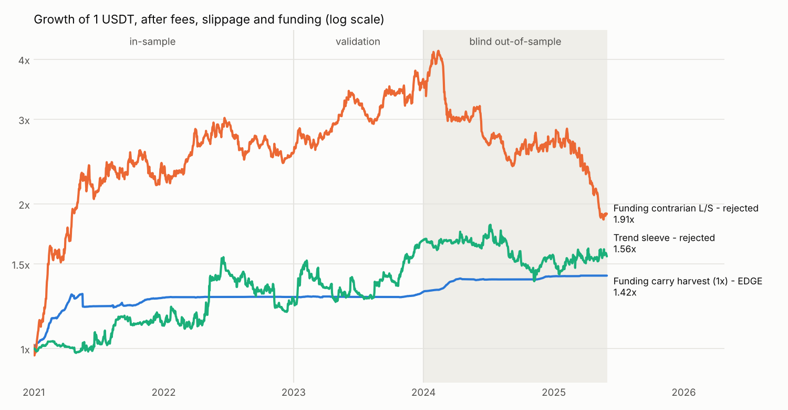
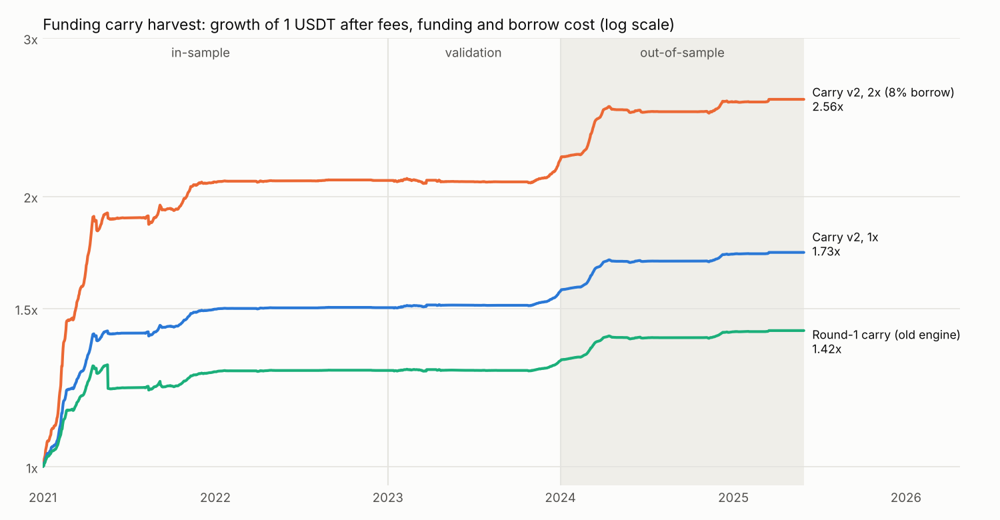
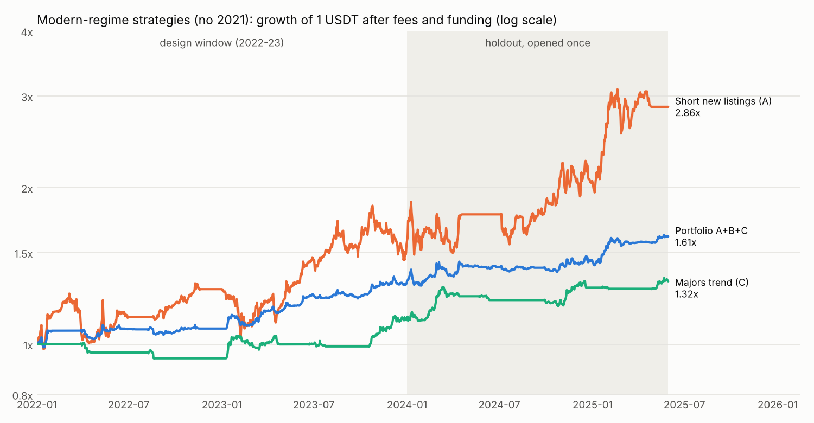
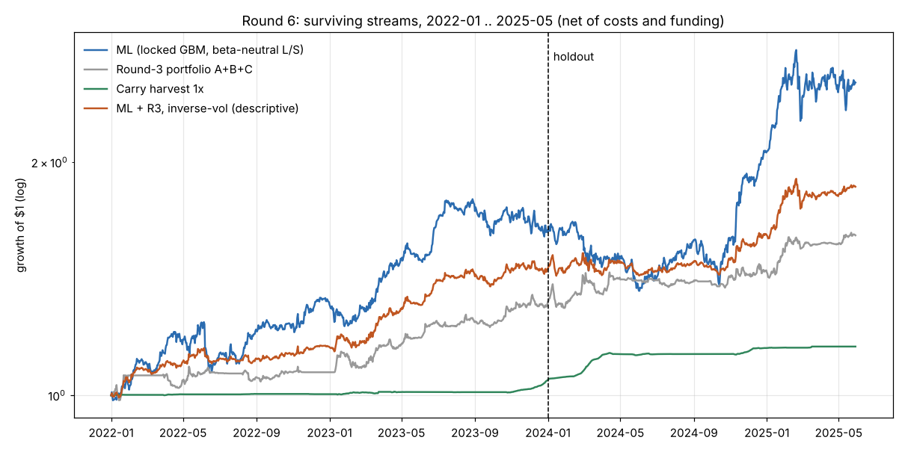

# Edge hunt: Binance USDT-M perpetuals, 2020-01 → 2025-05

**Bottom line.** I screened about 170 strategy variants across 15 hypothesis families. Most of them were deliberately unconventional. Exactly **one edge survived every test, including a blind out-of-sample period**: the **funding carry harvest**. It holds spot and shorts the same coin's perpetual when funding is rich, so you get paid for supplying leverage to the crowd.

| Funding carry harvest (1x) | Sharpe | Return | CAGR | Max DD | Daily PF |
|---|---|---|---|---|---|
| In-sample 2020-01 → 2022-12 | **3.02** | +46.4% | 13.5% | −6.3% | 3.1 |
| Validation 2023 | **3.23** | +2.4% | 2.4% | −0.5% | 2.0 |
| **Blind OOS 2024-01 → 2025-05-30** | **6.75** | **+8.1%** | 5.7% | **−0.7%** | 4.8 |

It is profitable in every calendar year (2020 +14.3%, 2021 +27.6%, 2022 +0.3%, 2023 +2.4%, 2024 +7.8%, 2025 YTD +0.3%). Correlation to BTC is close to zero.

At 2× or 3× notional the OOS CAGR rises to 11.7% or 18.0%, with OOS drawdowns of −1.5% and −2.2%. The IS drawdowns at those levels are −13% and −20% (see §4).

It is honest to say what this edge is **not**. It is not a 100%-a-year machine. It is a high-Sharpe, low-drawdown, *cyclical* income stream: rich when the market is levered up (2020–21, 2024), and near zero when it isn't (2022, 2025). It is also sensitive to costs (see §4).



---

## 1. Setup

* **Data.** Exchange APIs are blocked in this environment, so I used the public freqtrade-format mirror `DigiTuccar/HistoricalDataForTradeBacktest` at commit `553525c`. That gives 421 Binance USDT-M perps (1h), their 8h funding and mark prices, and 1h spot candles for the spot leg. Data ends on 2025-05-30. `fetch_data.sh` recreates it.
* **Costs.**
  * Perp: 0.05% taker plus 0.02% slippage per side.
  * Spot: 0.10% taker plus 0.02% slippage per side.
  * Actual historical funding is paid and received on every 8h settlement.
* **No lookahead.**
  * Signals at candle *t* use only data up to the close of *t*, and are executed over *t+1*.
  * Funding is only "known" once it has settled.
  * The universe is point-in-time: the top-N by trailing 30-day median quote volume, with at least 30 days of listing age.
  * `lookahead_test.py` truncates the data at 5 dates. Positions before each cut are **bit-identical** to the full-history run.
* **Splits fixed before any test.**
  * IS: 2020–2022. In practice it starts in 2021, because only 3 perps have 2020 data.
  * Validation: 2023.
  * **OOS: 2024-01 → 2025-05, untouched while designing.**
* **Pass criteria (set in advance).**
  * OOS Sharpe ≥ 1.5, positive return, max DD ≤ 25%, at least 100 trades, PF ≥ 1.3.
  * VAL Sharpe ≥ 1.
  * A parameter plateau, survival at 2× costs, and not just one coin.
* **OOS peeks used: 2.**
  1. The funding contrarian.
  2. The trend + carry ensemble, which reported each sleeve.

  The carry parameters were locked on IS and VAL before peek #2, and nothing about carry was changed afterwards. One more disclosure: a mechanical smoke test of the freqtrade pipeline ran on a 12-pair toy configuration over 2024-Q1.

## 2. What was tested (IS + VAL screening, OOS blind)

| Family | Idea | Verdict |
|---|---|---|
| A. Funding contrarian | Long the lowest-funding coins, short the most crowded | IS 2.2 / VAL 1.8, then **OOS −1.5 → rejected** |
| A'. Funding follow | The mirror image | Strongly negative |
| B. Momentum minus funding | "Un-levered rallies" | IS 2.2 / VAL 1.1; same failure mode as A |
| C. New-listing decay | Short perps in their first 14–60 days, hedged with BTC | Unstable sign |
| D. MAX / lottery | Short last week's biggest spike | Negative |
| E. Cross-sectional momentum / reversal | 1h → 30d horizons | 7–14d momentum weak (VAL 0.4–1.5); short horizons killed by fees |
| F. Low-volatility anomaly | | Negative |
| G. Abnormal volume | Shock × direction | Negative |
| I. BTC → alt lead-lag (1h) | | Fees destroy it (turnover 36×/day) |
| J. Funding change / own z-score | | Negative in VAL |
| L. Funding-settlement clock, weekend effect | | Clock trades killed by fees; weekend/weekday adds nothing |
| M. Spot–perp basis contrarian | | IS Sharpe 3.2, then decayed in VAL |
| N. Hour-of-day seasonality | | Fees destroy it |
| O/P/Q. Funding dispersion regime, funding volatility, wick bias | | Nothing |
| **R. Funding carry harvest** | Long spot + short perp, delta-neutral | **IS 3.0 / VAL 3.2 / OOS 6.8 → EDGE** |
| S/T. Trend following (vol-targeted, funding-filtered) | | IS 0.9 / VAL 1.4, then **OOS −0.2 → rejected** |
| Market timing with an aggregate-funding "froth gauge" | | Only cuts exposure; no improvement |
| Ensemble: 40% trend / 60% carry | | IS 1.7 / VAL 1.6, then **OOS 0.25 → rejected** (trend dragged it down) |

The raw tables are in `round1.csv` … `round5.csv`. The full reasoning for each rejected candidate is in `final_eval.log` and `final_eval_ensemble.log`.

**Why the most "exciting" find failed.** The funding contrarian made money from 2021 to 2023. In 2024–25 its long leg, the shunned low-funding coins, kept bleeding: −15% in 2024 and −39% in 2025. At the same time, crowded meme coins kept running.
* Only 7% of its 27 OOS parameter neighbours were profitable.
* A permutation test cannot distinguish its OOS result from random (p = 0.24).

That pattern is a regime-dependent anomaly. Carry is different: it is a payment for a service (absorbing leveraged demand), not a pattern.

## 3. The edge: funding carry harvest

**Rules.** These parameters were locked on IS and VAL; `carry_lab.carry`.
1. **Universe:** the point-in-time top 50 perps by 30-day median quote volume that also have a Binance spot market. A guard excludes ticker mismatches.
2. **Signal:** the 3-day average of settled funding.
3. **Enter:** when the coin ranks in the top 10 by that average **and** the average is > 0.01% per 8h (Binance's baseline rate).
4. **Hold:** until the average drops below 0.005% per 8h.
5. **Position:** buy spot and sell the same notional of the perp. Weight is `1/max(#held, 10)` of the hedged notional.
6. **Capital:** 1.2 × notional. The spot leg is fully funded, plus a 20% margin buffer, assuming a portfolio or cross margin account where the spot leg collateralises the perp.

**Where the money comes from** (sum of bar returns on capital):

| Year | Net | Funding received | Basis P&L | Fees | Avg. deployed |
|---|---|---|---|---|---|
| 2020 | +14.3% | +20.7% | +1.8% | −9.1% | 82% |
| 2021 | +27.6% | +40.4% | −6.7% | −8.7% | 84% |
| 2022 | +0.3% | +1.0% | +0.2% | −0.9% | 13% |
| 2023 | +2.4% | +6.1% | +1.1% | −4.7% | 45% |
| 2024 | +7.8% | +10.7% | +0.5% | −3.7% | 58% |
| 2025 (to 05-30) | +0.3% | +0.5% | +0.1% | −0.3% | 12% |

**Robustness:**
* **Parameter plateau** (`final_eval_carry.log` §4). With an entry threshold ≥ 0.01% per 8h, **18 of 18 neighbours** (k = 1/3/7 days × threshold 0.01/0.02% × top 5/10/20) are profitable in IS, VAL **and** OOS. Their OOS Sharpe ranges from 4.1 to 8.0.
* **Breakdown point.** Entering *below* the baseline rate (0.005%) churns and loses. That is the documented edge of the plateau, not noise.
* **Breadth.** In OOS, 127 round trips across 149 coins traded over the full history. The top-3 coins contribute only 11% of OOS profit.
* **Market neutrality.** BTC correlation is about 0.
* **The worst day is a conservative artifact.** The worst day in the sample was the 19 May 2021 crash, at −5.9%; it accounts for almost all of the −6.3% max drawdown. During the liquidation cascade the SUSHI, 1INCH and HOT perps printed 40–60% below spot for 1–2 hours, then reconverged. A real static hedge nets about zero over such a round trip. The harness, however, holds constant weights bar by bar, which means rebalancing every hour, so it books the dislocation as a loss. The reported drawdown therefore *overstates* this risk.
* **No lookahead.** `lookahead_test.py` → `NO LOOKAHEAD`.

## 4. Risks and caveats (read before trading)

1. **Costs are the Achilles heel.** At 2× my already-padded costs: IS Sharpe 1.4, VAL −2.3, OOS 2.8. At 3×, it is flat. Use maker orders or a lower fee tier, and do not chase small funding.
2. **It is cyclical.** It returned 0.3% in 2022 and 0.3% in 2025 YTD. Idle capital sits in stablecoins, and the dataset does not model the yield on that cash.
3. **Leverage and margin.** A 2–3× hedged notional is reasonable *only* with portfolio or cross margin, so that spot gains offset perp losses. On held short-perp legs the largest 24h pumps were DOGE +188% and SUSHI +125%. With isolated margin those would liquidate the perp leg and leave you unhedged.
4. **Spot-leg custody and borrow.** The spot leg is assumed fully owned, with no borrow. Exchange counterparty risk is not modelled.
5. **Survivorship.** The dataset includes some delisted perps (MATIC, EOS, ANT, TOMO, WAVES), but not all of them. Carry is delta-neutral, so missing blow-ups matter far less than for directional strategies.
6. **Execution of funding.** The model assumes funding is collected exactly as published. Real rates are capped and the settlement interval can change (4h on some coins in 2024–25). The 8h series here already reflects what was paid.
7. **Freqtrade can't run it as one bot.** A freqtrade strategy trades one market type per bot, so a simultaneous spot + perp hedge cannot be expressed or backtested in the freqtrade engine. The edge is therefore validated in the vectorized harness. `carry_signals.py` prints the target book from the latest data, for execution by hand or with a small executor.

## 5. Files

| File | Purpose |
|---|---|
| `fetch_data.sh` | Download the dataset (no exchange API needed) |
| `edge_lab.py` | Vectorized engine: panel loader, point-in-time universe, fees and funding, metrics |
| `carry_lab.py` | The carry harvest (the edge) |
| `carry_signals.py` | Current target book: `python3 carry_signals.py 10000 1` |
| `final_eval_carry.py` / `.log` | Full robustness battery for the edge |
| `lookahead_test.py` | Truncation test proving no future data is used |
| `screen_round1..5.py`, `round*.csv` | All screens (IS and VAL only) |
| `final_eval.py` / `.log` | OOS evaluation of the rejected funding contrarian |
| `final_eval_ensemble.py` / `.log`, `ensemble_lab.py` | OOS evaluation of the rejected ensemble (carry sleeve included) |
| `ft_offline.py` | Runs freqtrade backtesting/lookahead-analysis offline by synthesising market metadata |
| `rejected/` | The freqtrade port of the funding contrarian. **Do not trade it.** |
| `make_chart.py`, `equity_curves.png` | Figure above |

Reproduce:
```bash
user_data/edge_research/fetch_data.sh
```
```bash
cd user_data/edge_research && python3 final_eval_carry.py && python3 lookahead_test.py
```

---

# Round 2: chasing a smoother, higher curve (target max DD ≤ 10%)



**Bottom line.** The best robust curve is still the funding carry harvest. Two things changed:
1. A more realistic engine shows it is **far smoother** than round 1 reported.
2. It can carry **modest leverage**, as long as the cost of borrowing for the spot leg is charged.

| Carry harvest (same rules as round 1) | IS 2020–22 | VAL 2023 | OOS 2024-01→2025-05 | Worst DD 2021+ | Worst month |
|---|---|---|---|---|---|
| Round 1 engine, 1× | 13.5% / Sh 3.0 | 2.4% / Sh 3.2 | 5.7% / Sh 6.8 | −6.3% | — |
| **v2 engine, 1×** (8% borrow APR, unused at 1×) | **21.3% / Sh 6.3** | 4.2% / Sh 4.8 | 7.4% / Sh 6.9 | **−1.8%** | −0.2% |
| **v2 engine, 2×** (borrowing at 8% APR) | **40.3% / Sh 5.8** | 5.3% / Sh 3.1 | **11.7% / Sh 5.7** | **−3.7%** | −0.6% |

Calendar years at 2×: 2021 +107%, 2022 +0.4%, 2023 +5.3%, 2024 +16.2%, 2025 (to May) +0.7%.

The curve is very smooth, but it **steps**. It climbs when the market is levered up and goes flat when funding is cold. About 60–64% of months are positive, and the rest sit near zero rather than being losses.

## What changed and why

* **v2 engine (`carry2_lab.py`).** Holdings are now coin units that drift between trades. The round-1 engine held constant weights, which meant rebalancing every hour. That booked transient spot/perp dislocations as losses: the −6% on 19 May 2021 was an artifact. Equity now compounds, and fees are charged on the traded notional of both legs. Lookahead truncation test (`lookahead_test_v2.py`): **NO LOOKAHEAD**.
* **Leverage has a real cost** (`leverage_v2.py`). Above 1× you must buy more spot than you have cash for, so the shortfall is borrowed (USDT margin loan) and interest is charged every hour.

  | | 1× | 2× | 3× |
  |---|---|---|---|
  | VAL, 8% borrow | 4.2% | 5.3% | 6.1% |
  | OOS, 8% borrow | 7.4% | 11.7% | 15.8% |
  | VAL, 15% borrow | — | — | −0.9% |

  So size leverage to the borrow rate you actually get. Above about 12% APR, stay at 1×.

## What was tried and rejected in round 2 (all numbers in the logs)

| Idea | Result |
|---|---|
| Wider universe (top 100) | Small gain in VAL; kept as an option, not needed |
| Funding-proportional sizing | Worse (VAL Sharpe 1.8–4.8 vs 5–7) |
| "Smart leverage": borrow only where funding APR > borrow APR + 5% | **Worse** than flat leverage, because re-sizing churn eats the extra carry (`smartlev_v2.csv`) |
| S1 basis-spike carry | IS Sharpe 1.5–3.6, VAL 0.4–1.0 → rejected |
| S3 large-cap pairs stat-arb | Negative everywhere → rejected |
| **S2 liquidation-cascade reversion** (buy the most oversold alts after a market-wide 1h flush of ≥3%, hedge with BTC, exit after 6h) | IS Sharpe 2.8 / VAL 2.8, plateau positive in all 24 settings. **But:** about half the edge is in the first hour (entry 1h late: Sharpe 1.5–1.8). The freqtrade port (`strategies/EdgeHuntCascadeReversion.py`) makes +105% over 2021–25, almost all in 2021–22; 2023 −7%, 2024–25 flat. **Downgraded to experimental**, not part of the recommendation |
| Walk-forward portfolio, carry + cascade (`final_eval_v2.py`) | 2022→2025-05: CAGR 15.5%, Sharpe 4.2, max DD −2.4%, 99th-percentile bootstrap DD −3.2%. But it ignored borrow cost, the cascade sleeve decayed (2024 +1.9%, 2025 −6.7%), positive months were only 68%, and the deflated Sharpe was 0.37. **Not adopted** |

Note on freqtrade's `lookahead-analysis` for the cascade strategy: it reports "bias" because it re-runs each trade with the whitelist cut to that one pair (`freqtrade/optimize/analysis/lookahead.py:115`). That changes a cross-sectional universe, so the result is a false positive. The truncation test above keeps the full universe and is the valid check.

## Data freshness
No newer data source was found: the mirror and its fork stop at 2025-05-30, and the other candidate repos are older. So there is still **no untouched holdout** for round-2 choices. The 2024–25 period has now been seen several times, so treat its numbers as in-sample-ish for anything decided in round 2. The carry *rules* themselves were locked in round 1, before OOS.

## Recommendation
Run the carry harvest at **1×** if your USDT borrow rate is above about 12% APR, or **1.5–2×** if you can borrow at about 8% or less. Use cross or portfolio margin, maker or BNB-discount fees, and monitor funding. Expect 5–15% in normal years and much more in levered-up bull phases, with drawdowns that have stayed under 4%.

`carry_signals.py 10000 2` prints the target book.

---

# Round 3: strategies for today's market (2021 excluded)



**Why.** The carry harvest made most of its money in 2021-style leverage mania. If that regime doesn't return, carry yields roughly 0.4–10% a year. So round 3 ignores 2020–2021 completely:
- **Design window:** 2022–2023, covering the bear market, the FTX collapse and the recovery.
- **Holdout:** 2024-01 → 2025-05, opened once for the locked portfolio.

**Result.** The locked portfolio blends three independent return streams with inverse-volatility weights:

| | Design 2022–23 | **Holdout 2024–25** | Holdout at 2× costs |
|---|---|---|---|
| **Portfolio A+B+C** | Sharpe 1.59 · 14.5%/yr · DD −4.8% | **Sharpe 1.46 · 15.7%/yr · DD −6.9%** | Sharpe 1.35 · 14.5%/yr |

Calendar years: 2022 **+7.2%** (BTC −65%), 2023 **+22.3%**, 2024 **+10.6%**, 2025 Jan–May **+11.2%**. Correlation to BTC is 0.07. 71% of holdout months were positive; the worst month was −5.0%.

Checks:
- **Plateau:** all 27 neighbouring settings are profitable on the holdout (median Sharpe 1.55, minimum 1.20).
- **Best month removed:** the holdout is still +13.6%.
- **Lookahead:** truncation test passes (`lookahead_test_modern.py`).
- **Bootstrap drawdown** (2022–25, 10-day blocks): median −8.9%, 95th percentile −14.8%. Plan for drawdowns up to about 15%.

**Against the pass bar:** everything passes except the holdout Sharpe, which narrowly misses (1.46 vs 1.5). I did not re-tune to clear it.

## The three streams

| Stream | Idea | Design Sharpe | Holdout Sharpe / CAGR / DD | Avg weight |
|---|---|---|---|---|
| **A. Short new listings** (`modern_lab.dilution_short`) | Short perps in days 2–30 after listing, sized by inverse vol, 10% cap per coin, BTC long hedge. Thesis: low-float, high-FDV launches with unlock overhang decay against BTC. | 0.94 | **1.36 / 53.8% / −20.9%** | 12% |
| **B. BTC vs alts** (`btc_vs_alts`) | Long BTC / short the equal-weight top-30 alts while ALT/BTC is below its 20-day average | 0.76 | 0.14 / 0.5% / −19% (weak) | 21% |
| **C. Majors trend** (`majors_trend`) | BTC + ETH long or flat, 55-day breakout in, 20-day breakdown out, 15% vol target | 0.71 | **1.45 / 12.9% / −8.3%** | 65% |

A is positive every year (2022 +27.6%, 2023 +22.0%, 2024 +32.6%, 2025 Jan–May +38.7%), but it is volatile on its own. C is the stabiliser. B did little in the holdout but stays in, because it was locked beforehand.

## Rejected in round 3
- **D. Intraday mean reversion on majors** (5m, post-only limit entries, 12 variants): Sharpe −3 to −10 in the design window. Limit orders fill exactly when price keeps running (adverse selection). Dead.
- **A2. "Confirmed" dilution short** (short only below the coin's own EMA): worse than plain A (Sharpe 0.49–0.87).
- About 36 variants were tried in total (`modern_screen.csv`, `modern_screen2.log`).

## Freqtrade ports
- **`strategies/EdgeHuntMajorsTrend.py`** (C), with `config_majors_trend.json`.
  - 2022-01 → 2025-05: +35.9%, CAGR 9.4%, max underwater 4.8%. Years: −4.6% / +4.4% / +33.6% / +2.4%.
  - Signs match the harness each year. Magnitudes differ because freqtrade sizes each trade once at entry, while the harness re-sizes daily.
  - freqtrade `lookahead-analysis`: **no bias**.
- **`strategies/EdgeHuntDilutionShort.py`** (A), with `config_dilution_short.json`.
  - Shorts new listings and keeps a BTC hedge. Every leg is re-sized to target daily via `adjust_trade_position`.
  - 2022-01 → 2025-05: **+149%** in total, against +186% for the harness stream.
  - freqtrade's yearly split and its "max underwater" (−55%) count profit only when a trade closes. The BTC hedge stays open for months, so its gains are booked late, while short losses are booked as they happen. Use the harness's hourly mark-to-market figures for drawdown.
  - Two porting traps, both fixed and documented in the code:
    - Freqtrade's backtester drops the first `startup_candle_count` candles of *every* pair (`converter.trim_dataframe`). That erases a new listing's first weeks, so the strategy uses a 24-candle startup.
    - Without daily rebalancing, squeezed shorts grow huge. The first port had −42% DD, and its short side lost money.
- **B** is not ported. The portfolio weighting (inverse-vol across three books) has to run outside a single freqtrade bot: either three bots with capital split by the weights in `final_eval_modern.log`, or a small allocator.

## How to use it
Run C and A as separate freqtrade bots, plus B if you want the full locked mix. Split capital roughly 65 / 12 / 21, matching the average holdout weights, or recompute the inverse-vol weights monthly. Expect about 10–20% a year with Sharpe around 1.5 and drawdowns of 7–15%, in markets like 2022–2025.

---

# Round 4: searching for more modern-regime strategies (result: none added)

The protocol was the same as round 3: design on 2022–23 only, then open the 2024-01 → 2025-05 holdout once per new family.

**Entry gate (design window):**
- Sharpe ≥ 0.8
- 2022 and 2023 both positive
- positive at 2× costs
- correlation below 0.5 to streams A, B and C

## Batch 1 (`screen_modern_r4.py` → `modern_r4_screen.csv`)

| Family | Idea | Design Sharpe | Verdict |
|---|---|---|---|
| E. Pullback in uptrend | Buy BTC/ETH/SOL/BNB/XRP dips more than k·ATR below the 20-day EMA while above the 100-day EMA | −0.5 to −0.9 | rejected |
| F. Coin/BTC ratio trend | Donchian breakout on 8 coin/BTC ratios, market-neutral | 0.09–0.58 | rejected, and 0.5 correlated with B |
| G. Daily shock reversal | Fade a >k·σ daily move that goes against the 50-day trend | 0.9–1.0 at k=3, negative at k=2 | rejected: only **5 trades** in 2 years |
| H. Broad majors trend | C applied to the top 10/20 coins | 0.07–0.47 | rejected, and 0.8 correlated with C |
| I. Young-coin short | A applied to coins aged 30–180/365 days | 0.24–0.33 | rejected, and 0.8 correlated with B |

## Batch 2 (`screen_modern_r4b.py`, `screen_modern_r4c.py`)

| Family | Idea | Design Sharpe | Verdict |
|---|---|---|---|
| J. Weekend effect | Long BTC, or short alts vs BTC, on weekends only | −0.3 / −0.4 | rejected |
| K. Turn of month | Long BTC around month end | −0.1 to −0.3 | rejected |
| L. Funding capitulation | Long BTC/ETH when market-wide funding is in its bottom 10–30% | about 0 | rejected |
| M. Pump short | Short top-100 coins after a big 24h pump, BTC hedge | 20–40% pumps: −0.2 to −1.4; **≥ 50% pumps: 0.84–0.99** | passed the gate → holdout |

**Holdout for M** (locked at 50% / 2 days / 5% per position; `final_eval_modern_r4.py`):

| | Design | Holdout |
|---|---|---|
| M alone | Sharpe 0.88 · 7.2%/yr | **Sharpe −0.18 · −2.9%/yr** (2024 −7.6%) |
| Portfolio A+B+C+M | 1.84 · 11.7%/yr | 1.17 · 9.1%/yr: **worse than round 3** (1.46 · 15.7%/yr) |

**M is rejected.** The 60% and 75% thresholds stayed positive on the holdout (Sharpe 0.7–1.7). Switching to them after seeing the holdout would be selection on the answer, so they are only a *watch-list idea* for forward paper trading.

## Takeaway
About 60 more variants across 9 families produced nothing that both passed the design gate and survived the holdout. **The round-3 portfolio (A+B+C) is still the best result.**

The easy price- and funding-based signals in this dataset now look exhausted. Further real edges probably need data that isn't available here:
- open interest and liquidation feeds
- order-book depth
- token-unlock calendars (to sharpen stream A)
- cross-exchange funding and basis
- on-chain flows
- data after 2025-05 for a genuinely fresh test

---

# Round 6: audit everything, then go after what simple signals miss



**Bottom line.**
1. **The carry harvest is the only edge that survives every test, including a multiple-testing correction.** But it is a **small-capital edge**: under a conservative impact model it stops paying above roughly $1–2M.
2. **The round-3 portfolio is not statistically established.** Its holdout Sharpe of 1.45 is significant on its own (PSR 0.96), but not once you account for the ~8 independent bets searched to find it (deflated Sharpe 0.70, where 0.95 is the bar). Selecting the best design-window stream is close to a coin flip (PBO 0.53).
3. **A new ML model (gradient-boosted trees over 39 point-in-time features) finds real, stable predictability**: rank IC 0.11–0.14 in *every* year 2022–2025, t = 13 over 2022–25. The pre-registered book **passed** its one-shot holdout (Sharpe 1.24, CAGR 36%, 2024 +26%, 2025 YTD +23%). However, the P&L is lumpy: holdout −5% without its best 3 months, a −24% drawdown lasting 15 months, deflated Sharpe 0.5–0.6. **Paper-trade it; don't fund it yet.**
4. **Every attempted upgrade to carry failed honestly**, which is evidence the round-1 rules are not over-tuned.
5. **Data bug found:** 37 pairs in the mirror have truncated histories. It biased stream A *against* itself, so no prior result was inflated by it.

## 6.1 Reproduction and data audit (`r6_common.py`, `r6_audit_dilution.py`)

* **Reproduction.** Rebuilt the dataset from `fetch_data.sh`. The carry leverage table and the round-3 holdout (Sharpe 1.458, 15.7%/yr) reproduce exactly. One pandas-3 fix: `carry2_lab` wrote into a read-only array.
* **Truncated histories.** The mirror does not always start a pair at its real listing:
  * 15 perps (ENA, TAO, ZRO, ZK, NOT, W, IO, …) start at exactly 2024-07-04 00:00, with $36–615M of first-day volume. They actually listed in April–June 2024.
  * 1000SHIB, 1000LUNC, 1000XEC and LUNA2 start at exactly 2023-01-01.
  * ICP, TLM, BNX, RIF, MOVR, FXS, W and CVC have funding history months or years older than their candles.

  Stream A (short new listings) read "first candle" as the listing date, so it shorted established coins as fresh launches. Those fake listings lost 13.9% in 2023 and 5.8% in 2024. With clean listing dates, stream A improves (holdout Sharpe 1.36 → 1.45) and the locked portfolio is unchanged (1.46 → 1.45). `listing_age_hours_clean` is the fix: first candle and first funding agree within 2 days, and the pair is not part of a ≥3-pair batch cut at 00:00.
* **Funding intervals.** Binance moved many coins to 4h (and some to 1h) funding. The funding files contain every settlement, so carry **P&L is correct**. The carry **signal**, however, averages the rate *per settlement*, which understates carry per 8h for those coins. Fixing it made results *worse* (see 6.4).
* **No data after 2025-05-30 was available.** Exchange APIs are blocked by this environment's network policy, and attaching another public dataset repository was not permitted in this session. A truly fresh test still needs data from June 2025 onward.

## 6.2 Overfitting audit (`r6_trials.py`, `r6_overfit.py`, `r6_overfit.log`)

I rebuilt the daily returns of all 71 single-stream trials from rounds 3–4 and the 27 portfolio neighbours, 2022-01 → 2025-05. Their correlation spectrum gives an **effective N of 8.4** independent trials (the 27 portfolio neighbours count as 1.2).

**CSCV** (16 blocks, all 12,870 half/half splits):

| Trial set | PBO | OOS Sharpe of the IS winner (median) | P(IS winner loses OOS) |
|---|---|---|---|
| Single streams | **0.53** | 0.43 | 18% |
| Portfolio neighbours | 0.81 (the 27 are nearly one strategy) | 1.27 | 0% |
| Everything | 0.51 | 0.75 | 12% |

**Deflated Sharpe.** This is the probability that the true Sharpe beats the best of N skill-less trials; 0.95 is the significance bar. The trial-Sharpe variance comes from the round-3/4 design window.

| Claim | Sharpe | PSR | DSR N_eff = 8 | DSR N = 361 |
|---|---|---|---|---|
| Carry 1×, OOS 2024–25 | 6.93 | 1.000 | **1.000** | **1.000** |
| Round-3 portfolio, holdout | 1.45 | 0.962 | 0.702 | 0.241 |
| Stream A / C / B, holdout | 1.36 / 1.47 / 0.10 | 0.95 / 0.96 / 0.55 | 0.66 / 0.71 / 0.14 | ≤ 0.25 |
| ML book, holdout | 1.23 | 0.926 | 0.573 (N = 10) | 0.484 (N = 18) |
| ML book, walk-forward 2022–25 | 1.30 | 0.991 | 0.660 (N = 10) | 0.526 (N = 18) |

The design-window ranking does carry some information into the holdout: Spearman 0.35 over 71 trials, p = 0.003. However, it is too weak to make "best in design" a reliable pick.

There is also a statistical-power point. Stream C carries 65% of the round-3 portfolio, and it opened **10 positions** in the whole holdout. Seventeen months of a Sharpe-1.5 strategy cannot be told apart from luck once you have searched; that takes years, or a much higher Sharpe.

## 6.3 ML cross-sectional alpha (`r6_ml_features.py`, `r6_ml_alpha.py`, `r6_ml_LOCK.md`)

Rounds 1–4 tested signals one at a time. Here, 39 point-in-time features feed one model. Each feature is ranked cross-sectionally per day; the market-state features are kept raw.

| Feature group | Features |
|---|---|
| Momentum | 1–60d momentum; residual momentum vs BTC |
| Volatility and tails | volatility, downside volatility, skew, MAX/MIN, range |
| Liquidity and volume | Amihud illiquidity, volume shocks |
| Funding | funding paid (interval-agnostic) level, change and z-score |
| Basis and spot | perp–spot basis, spot availability |
| Structure | BTC beta and correlation, clean listing age |
| Market state | BTC trend and volatility, breadth, average funding, dispersion |

* **Protocol.**
  * Universe: point-in-time top-100 perps.
  * Target: 3-day forward return including funding, net of the cross-sectional mean.
  * Model: LightGBM, 3 seeds, with a ridge baseline.
  * Walk-forward: retrained monthly from 2022-01, with a purge and embargo so that no training target overlaps the prediction month.
  * Book chosen on 2022–23 only, then **committed to git (`r6_ml_LOCK.md`, commit 2143d4c) before the 2024–25 holdout was opened once.**
* **Leakage check.** The IC barely moves when entry is delayed by 1–24h (0.124 → 0.106), so this is not a close-price or timing artifact.
* **Nonlinearity matters.** Ridge on the same features has similar IC but makes ~0 in the design window.
* **Locked book.** Long the top quintile and short the bottom quintile, equal weight, with a BTC hedge cancelling the 30-day net beta and a 3-day staggered hold.
  * **Why the beta hedge.** The plain long/short had −0.28 correlation to BTC: the model's shorts are high-beta coins.

| Locked ML book | Sharpe | CAGR | Max DD | Years | IC (t) |
|---|---|---|---|---|---|
| Design 2022–23 | 1.45 | 27.9% | −13.8% | 2022 +32.0%, 2023 +23.9% | 0.126 (10.9) |
| **Holdout 2024–25, 1× costs** | **1.24** | **36.4%** | −19.0% | 2024 +25.9%, 2025 YTD +23.2% | 0.117 (7.4) |
| Holdout, 2× costs | 0.95 | 25.9% | −21.4% | 2024 +16.1%, 2025 YTD +19.3% | |

Pass bar (Sharpe ≥ 1.0, both years positive, DD ≤ 25%, positive at 2× costs): **passed**.

**What tempers it** (`r6_ml_concentration.log`):
* **Concentrated holdout gains.**
  * Jan–Oct 2024: −3.1%
  * Nov 2024–Feb 2025: **+43.8%**
  * Mar–May 2025: +11.2%
  * Without the best 3 holdout months: −5.3%.
* **Long underwater period.** Max DD over 2022–25 is −23.9%, from a peak in Aug 2023 to a trough in Jun 2024; it recovered in Nov 2024.
* **Not significant after deflation.** DSR is 0.5–0.66 (6.2).

So the *prediction* is robust, but the current *book* monetises it unevenly. The long leg alone loses money (holdout Sharpe 0.35). The obvious next step is better portfolio construction from the same predictions, such as prediction-weighted sizing, risk-model neutralisation and turnover-aware optimisation. That must be designed on 2022–23 and tested on new data.

**Capacity** is far larger than carry, since it trades perps only, in the top 100. A coin's daily trade reaches 1% of its 24h volume at $12M AUM for the 99th-percentile trade and $120M for the median.

## 6.4 Carry upgrades (`r6_carry.py`): all rejected

Design 2020–23; OOS opened once under a rule committed beforehand (`r6_ml_LOCK.md`).

| Variant | IS Sharpe | VAL Sharpe | VAL Sharpe at 2× costs | OOS Sharpe (2× costs) | Verdict |
|---|---|---|---|---|---|
| V0 locked round-1 rules | 6.34 | 4.76 | 0.23 | 6.93 (4.10) | **kept** |
| V1 interval-normalised signal | 5.66 | 2.30 | −3.88 | 5.90 (1.82) | rejected |
| V2 LightGBM funding forecast | 3.56 | 2.05 | −3.47 | 4.76 (0.10) | rejected |
| V3 forecast + cost hurdle | 4.54 | 6.21 | 2.50 | 6.33 (3.68) | rejected: fails its adoption rule (2× costs OOS Sharpe must beat V0's) |

* **The forecast is better than the trailing average.** In OOS its correlation with the next 7 days of funding is 0.52, against 0.37 for the trailing 3-day average.
* **But trading it is worse.** Forecasting funding isn't the bottleneck; transaction costs are.
* **Why fixing the interval made things worse.** Binance moves coins to shorter intervals when funding spikes, and the spikes mean-revert within days. Measuring those coins correctly pulls them into the book at the worst time. The old signal under-weights them, which acts as an accidental filter.

## 6.5 Carry capacity (`r6_capacity.py`)

The model: executed trades only (honouring the simulator's re-size band), square-root impact `0.5·σ_daily·√(trade/ADV)`, and each leg charged against its own market's 24h volume. Y = 0.5 is deliberately conservative.

| AUM | Impact per leg | IS CAGR | VAL 2023 | OOS CAGR / Sharpe |
|---|---|---|---|---|
| $0.1M | 3.6 bp | 17.9% | +2.5% | 6.6% / 6.0 |
| $1M | 11.4 bp | 10.7% | −1.0% | 5.0% / 4.2 |
| $5M | 25.5 bp | −1.1% | −7.0% | 2.1% / 1.5 |
| $20M | 50.9 bp | −19.4% | −17.0% | −2.9% / −1.5 |

* **The spot leg binds in 96% of trades.** Rich funding concentrates in thin alts.
* **Cold years are tightest.** In 2022 and 2025, a median-sized trade hits 1% of daily volume at about $3.5M AUM.

## 6.6 How the survivors combine (`r6_combo.py`)

Daily correlations over 2022–25: carry vs ML −0.01, carry vs round-3 0.01, ML vs round-3 0.28.

A fixed 90-day inverse-vol mix of ML + round-3 gives:
* design: Sharpe 2.06, 20.6%/yr, DD −5.0%
* holdout: Sharpe 1.46, 19.1%/yr, DD −8.5%

The components' holdouts were opened before this mix was formed, so these numbers are **descriptive, not a test**.

Inverse-vol mixes that include carry are dominated by carry's tiny volatility. Run carry as a separate small account instead.

## 6.7 Recommendation after round 6

| Stream | Status | Use |
|---|---|---|
| Carry harvest (round-1 rules) | Proven (DSR 1.00) | Trade it, sized ≤ about $1–2M, maker/BNB fees, 1× unless borrow is cheap |
| ML book (`r6_ml_LOCK.md`) | Predictive signal proven (IC t = 13); P&L not yet (DSR 0.5–0.66) | Paper-trade from now; fund only after about 6–12 months of live IC ≥ 0.06 and positive P&L |
| Round-3 portfolio | Plausible, not proven (DSR 0.70) | Small allocation at most; treat as paper trading |

**Highest-value next steps:**
1. Data from June 2025 onward, for a genuinely untouched test of all three. This is one `freqtrade download-data` run on a machine with exchange access.
2. Portfolio construction for the ML predictions, designed on 2022–23 only.
3. Open-interest and liquidation data as model features.

## 6.8 Files

| File | Purpose |
|---|---|
| `r6_common.py` | Clean listing dates, per-pair P&L, stats |
| `r6_audit_dilution.py` / `.log` | Truncated-history audit of stream A and the portfolio |
| `r6_trials.py` | Rebuilds the daily returns of all 98 modern-regime trials |
| `r6_overfit.py` / `.log` | CSCV PBO, PSR, deflated Sharpe, selection-rule check |
| `r6_ml_features.py`, `r6_ml_alpha.py` | Feature panel, purged walk-forward, books (`--holdout`, `--reuse`) |
| `r6_ml_LOCK.md` | Pre-registration for the ML book and the carry OOS rule |
| `r6_ml_design.log`, `r6_ml_holdout.log`, `r6_ml_*.csv` | ML results |
| `r6_ml_concentration.log` | Holdout concentration and drawdown duration |
| `r6_carry.py`, `r6_carry_design.log`, `r6_carry_oos.log`, `r6_carry_*.csv` | Carry upgrades V1–V3 |
| `r6_capacity.py` / `.log` | Carry capacity |
| `r6_combo.py` / `.log`, `equity_curves_r6.png` | Correlations, mixes, ML capacity, ML deflated Sharpe, chart |

Reproduce (about 1.5 h on 4 cores; needs `pip install pyarrow numba lightgbm scipy matplotlib`):
```bash
cd user_data/edge_research && ./fetch_data.sh '-(1h-futures|8h-funding_rate|8h-mark)\.feather$' && ./fetch_data.sh '^binance/[A-Z0-9]+_USDT-1h\.feather$'
```
```bash
cd user_data/edge_research && python3 r6_audit_dilution.py && python3 r6_trials.py && python3 r6_overfit.py && python3 r6_ml_alpha.py && python3 r6_ml_alpha.py --holdout && python3 r6_carry.py --oos && python3 r6_capacity.py && python3 r6_combo.py
```
